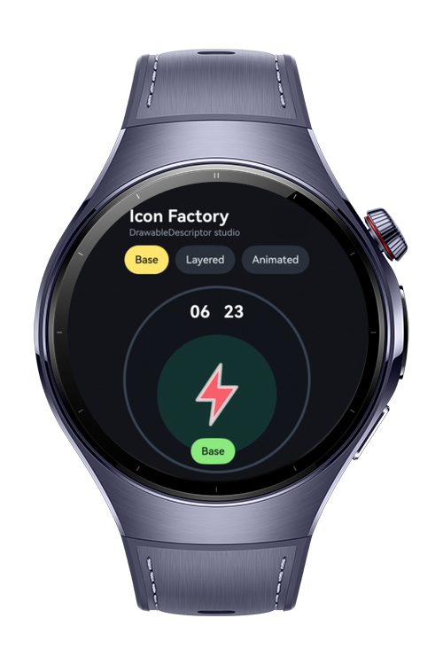
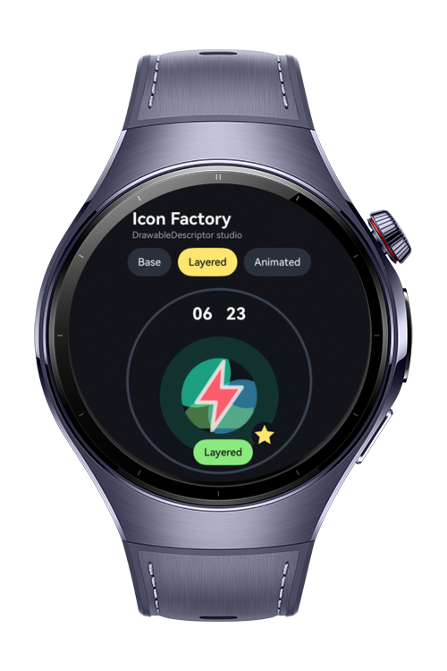
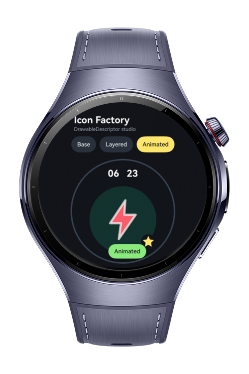

> **Note:** To access all shared projects, get information about environment setup, and view other guides, please visit [Explore-In-HMOS-Wearable Index](https://github.com/Explore-In-HMOS-Wearable/hmos-index).

# How to Build Animated Icon Factory

This app is a wearable app-icon customization studio that uses `DrawableDescriptor` for obtaining standard icon resources from app media files, `AnimatedDrawableDescriptor` for creating frame-by-frame PixelMap animated icons with configurable playback, `LayeredDrawableDescriptor` for composing adaptive foreground/background/mask icon resources, and `drawableDescriptor` as the base module namespace for descriptor utility functions. The codelab teaches building a personalized launcher icon editor where users can combine layers, add animation frames, and preview the result on a watch home screen.

# Preview

<div>
  
  
  
</div>

# Use Cases

- Load app media resources by name as `DrawableDescriptor` instances and display them through `Image`.
- Check loaded drawable dimensions with `loadSync`.
- Convert selected drawable resources to `PixelMap` frames with `getPixelMap`.
- Compose adaptive foreground, background, and mask layers with `LayeredDrawableDescriptor`.
- Overlay badge art in ArkUI because `LayeredDrawableDescriptor` does not expose a badge constructor parameter.
- Create frame-by-frame animated icons with `AnimatedDrawableDescriptor`.
- Configure animation duration, loop count, per-frame durations, and auto-play behavior.
- Control animated icon playback with `getAnimationController(id)`.
- Preview base, layered, and animated icon states inside a wearable launcher surface.

# Technology
## Stack

- **Languages**: ArkTS, ArkUI
- **Frameworks**: HarmonyOS SDK 6.0.1(21)
- **Tools**: DevEco Studio 6.0.1, Hvigor
- **Libraries**:
    - `@kit.AbilityKit`
    - `@kit.BasicServicesKit`
    - `@ohos.arkui.drawableDescriptor`
    - `@ohos.multimedia.image`

## Drawable Descriptor Modules

- `DrawableDescriptor`: Uses `resourceManager.getDrawableDescriptorByName(...)` to obtain media resources, then calls `loadSync()` for image metadata and `getPixelMap()` for animation frame creation.
- `AnimatedDrawableDescriptor`: Uses the documented `Array<PixelMap>` constructor with `duration`, `iterations`, `frameDurations`, and `autoPlay` options.
- `LayeredDrawableDescriptor`: Uses the documented foreground/background/mask constructor for adaptive icon composition.
- `drawableDescriptor`: Imported as a namespace from `@ohos.arkui.drawableDescriptor` so the sample can expose concise descriptor type aliases and factory helpers.
- `AnimationController`: Uses `getAnimationController('factoryAnimatedPreview')` after the animated `Image` component is rendered with the matching id.

# Directory Structure

```
entry/src/main/ets/
├─ model
│   ├─ IconDescriptorFactory.ets
├─ pages
    ├─ Index.ets

entry/src/main/resources/
├─ base
|   ├─ element
|   ├─ media
|     ├── icon_background_aurora.svg
|     ├── icon_background_pulse.svg
|     ├── icon_background_solar.svg
|     ├── icon_badge_check.svg
|     ├── icon_badge_heart.svg
|     ├── icon_badge_star.svg
|     ├── icon_foreground_bolt.svg
|     ├── icon_foreground_orbit.svg
|     ├── icon_foreground_route.svg
|     ├── icon_mask_watch.svg

```

# Constraints and Restrictions

## Supported Device

* Huawei Watch 5
* DevEco Studio wearable simulator

# License

**How to Build Icon Factory** is distributed under the terms of the MIT License. See the [LICENSE](LICENSE) for more information